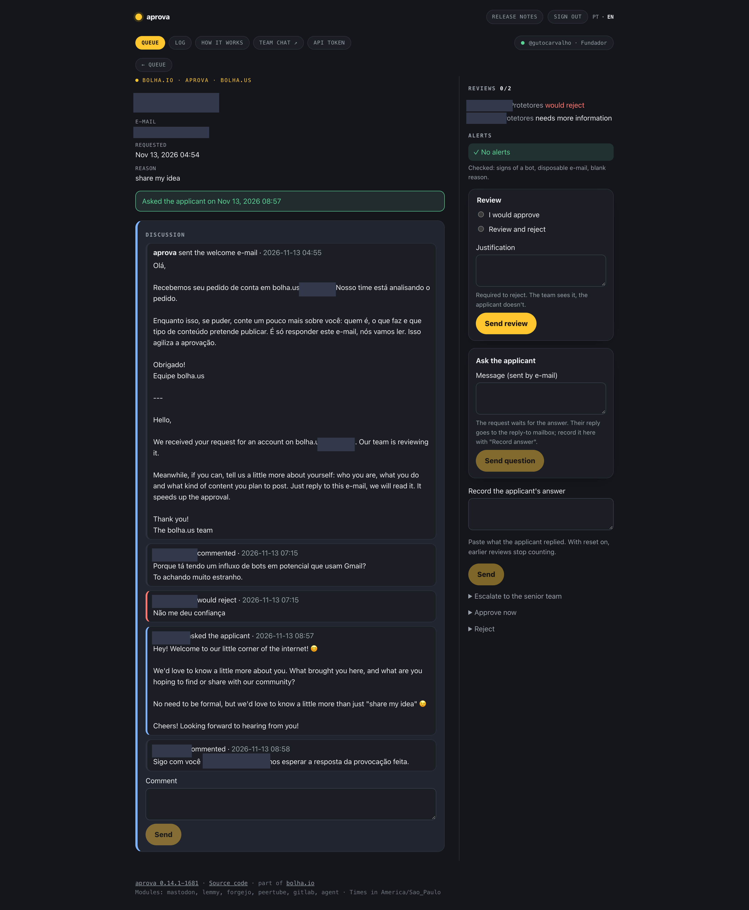

# aprova

One queue to approve sign-ups across the apps of a community. Moderators sign in with their Mastodon account, review requests together, ask applicants for more information, escalate doubtful cases and decide. The core knows no app: each app is a module, and an installation turns on the ones it uses.

## How it works

1. a moderator signs in at the panel with their account on the instance (OAuth); aprova checks they have a moderation role;
2. aprova asks each enabled app, through its module, for the sign-ups waiting for approval, and shows them in one queue with the automatic checks;
3. moderators review ("I would approve", "I would reject", "needs more information"), discuss, or e-mail the applicant a question;
4. when the rules say so (a quorum, a reject, an escalated decision), aprova re-reads the request in the app and approves or rejects it there, through the app's own API.

A quorum of matching reviews (2 by default, a majority of a panel of three) decides on its own; a reject blocks an automatic approval; doubtful cases escalate to senior roles who decide alone. Rejection and the applicant e-mails are always aprova's own voice, never the internal reason. Portuguese and English, a JSON API, and a decision log. The full list is in [Features](#features).

## Screenshot




*The queue and a request under review on a live instance; applicant and moderator data is masked.*

## Modules

| Module | App | Access |
|---|---|---|
| `mastodon` | Mastodon | The moderator's own token (admin scopes), or a service account's |
| `gitlab` | GitLab with admin approval of new users | Admin token: GitLab has nothing smaller. GitLab's reject e-mails the person, so the module rejects by deleting the user right after checking it is still pending (no hard delete: if it was approved meanwhile, its contributions go to the ghost user). It only calls list, read, approve and that delete, and a test fails if it calls anything else |
| `lemmy` | Lemmy with "require application" (tested on 0.19) | JWT of a dedicated admin account. Lemmy always e-mails a denied applicant, so the module rejects by purging the applicant instead (no e-mail; the local user and its application go, the name stays banned), and only an account whose application is undecided and that was never accepted or made admin. No reason is sent, the modlog is public. Approving still gets Lemmy's welcome |
| `forgejo` | Forgejo with manual confirmation of new accounts (`REGISTER_MANUAL_CONFIRM`) | Site admin token (`read:admin`, `write:admin`, `read:user`). Approving activates the account; rejecting deletes it (purge), only if it is still inactive and never signed in. Forgejo sends no e-mail either way. A test fails if the module calls anything but these user paths |
| `writefreely` | WriteFreely with the sign-up approval patch (`open/custom/writefreely`, `approval_required`) | The instance's `approval_api_key`, which only reaches `/api/admin/registrations`. Lists pending accounts with their e-mail and reason; approving lifts the hold; rejecting deletes the account, which WriteFreely does only while it is still pending. WriteFreely sends no e-mail either way |
| `peertube` | PeerTube with registration approval (8.3+) | `token_env` holds `username:password` of a dedicated Moderator user (password grant; the token is kept in memory and refreshed). Reject is silent; accept lets PeerTube send its welcome |
| `agent` | Apps with no approval API, through `aprova-agent` (see [The agent](#the-agent)) | A secret shared with the agent; every request is signed |

`aprova-agent` recipes: `pixelfed` (curated onboarding), `bookwyrm` (invite requests), `friendica` (sign-ups awaiting approval).

Choose the modules in the configuration (`modules: [mastodon, gitlab]` or `all`). A module that isn't listed registers no route, opens no connection and reads no secret. To leave one out of the binary: `go build -tags no_gitlab`. New apps are easy to add — see [Writing a module](#writing-a-module).

## Install

aprova needs **PostgreSQL**, an **OAuth app** on your sign-in instance, and to run **behind HTTPS** (the session cookie needs it). The instance and the apps you approve go in the YAML config ([`config.example.yaml`](config.example.yaml)); the secrets go in the environment ([`.env.example`](.env.example)).

**Register the OAuth app** on the sign-in instance (any install path needs this):

```sh
curl -F client_name=aprova \
  -F "scopes=profile admin:read:accounts admin:write:accounts" \
  -F redirect_uris=https://aprova.example.social/auth/callback \
  https://example.social/api/v1/apps
```

With no `auth: moderator` service, `profile` alone is enough.

### Docker

The quickest way. [`docker-compose.yml`](docker-compose.yml) runs aprova with a PostgreSQL that applies `schema.sql` on first boot and creates a limited app role.

```sh
cp .env.example .env                 # OAuth app, a key (openssl rand -hex 32), a DB password
cp config.example.yaml aprova.yaml   # your instance, and the apps you approve
docker compose up -d
```

It listens on `127.0.0.1:8080`; put your HTTPS reverse proxy in front. Pin the image to a released tag in production (see [Versions](#versions)).

### Kubernetes

Run the image (`registry.gutocarvalho.net/images/aprova`) as a Deployment: `aprova.yaml` in a ConfigMap mounted at `/config`, the secrets in a Secret given through `envFrom`, a PostgreSQL you provide (apply `schema.sql` as its owner, with a limited role for the app), and your ingress terminating TLS. For apps with no approval API, run `aprova-agent` next to each one — see [The agent](#the-agent).

### From source

```sh
go build -o aprova .    # add -tags no_<name> to leave a module out of the binary
```

Create the database and apply `schema.sql` as its owner — the app user can't change the schema and can only add to the comments and the log. Then run `./aprova` with the variables of `.env.example` set and `APROVA_CONFIG` pointing at your filled config.

## Features

- **Reviews like a pull request:** "I would approve", "I would reject" or "needs more information". A quorum of matching reviews (2 by default, a majority of a panel of three) decides on its own, approving or rejecting with the token of the moderator whose review completes it. A reject blocks an automatic approval; approve and reject at once escalate.
- **Checks:** signs of automated sign-ups and disposable e-mail (domain or MX host) keep the quorum from approving.
- **Discussion:** internal comments on each request. The applicant never sees them.
- **Ask the applicant:** an e-mail with the moderator's question; the request waits, and the answer starts a new round of reviews. With `APROVA_IMAP_*` set, aprova reads the reply-to mailbox every minute and attaches the answer itself: it matches the question's Message-ID, accepts only the applicant's own address (kept as a hash), and drops the quoted text. Moderators can still paste an answer by hand.
- **Welcome e-mail:** with `mail.welcome: true` on a profile, every new request gets an e-mail right away (built-in text in Portuguese and English, or `welcome_subject`/`welcome_body` from the config) asking who the person is, what they do and what they will post. It is the first item of the request's discussion and is tracked like a question: the reply is attached, and a bounce flags the request "e-mail not delivered" at once. It is not a vote and does not put the request in waiting. Only requests under 72 hours old with nothing on them yet are greeted, so turning it on doesn't mail a backlog. Services that can be listed without a moderator (`auth: token`, or `digest_token_env`) are greeted within a minute; `auth: moderator` ones when a moderator opens the queue.
- **How it works page:** the panel's top menu explains, per profile and from the running config, what approves or rejects on its own (quorums, blocks, escalation, rounds, bounces).
- **Bounces:** if the question e-mail comes back undeliverable (a non-existent address), aprova flags the request "e-mail not delivered" in the panel, so a fake sign-up is easy to reject. It reads the sender mailbox too, once a minute (see [Mail](#mail)). Off by default it only flags; `auto_reject_on_bounce: true` makes a bounce reject the request on its own (never for `auth: moderator` services, which have no system token).
- **Edits:** authors fix their own comments; the old text goes to the decision log.
- **Escalation:** to the senior roles of a profile, who then decide alone.
- **Notices:** a digest of pending sign-ups and escalations, by Mattermost webhook and/or direct messages from a bot account on the instance. Both off unless configured; each moderator can turn the bot's messages off in the panel. The bot's recipients can be listed by name or by role on the instance (`recipient_role_ids`, looked up with an `admin:read:accounts` token), and `digest_hours` keeps its digest to a few fixed hours a day. Messages never carry e-mails or reasons.
- **Rejection:** with an internal reason. The applicant always gets aprova's standard, configurable message (`reject_subject` / `reject_body`), never the reason. Modules reject without messaging the applicant wherever the app allows it, so aprova is the only voice.
- **Approval e-mail:** optional (`mail.approve`). Once approved, the person also gets aprova's own message, besides the app's: where to sign in and whatever the community wants to point to (rules, conduct, other services).
- **Profiles:** group services and say which roles approve, bulk reject and decide escalated requests.
- **API first:** everything the pages do is in the JSON API, with an aprova token made on the "API token" page.
- Decision log, Portuguese and English.

## Mail

Asking the applicant, reading answers and spotting bounces use two mailboxes, both read over IMAPS once a minute:

- **Sender** — `APROVA_SMTP_USER` (e.g. `aprova@bolha.us`). Questions go out from here (`profiles.*.mail.from`), so it is also the envelope sender: **delivery-status notifications (bounces) return to it.** aprova reads it with the SMTP credentials — on a mail server where one account shares its password across SMTP and IMAP (poste.io, Dovecot, and most others), no extra secret is needed. A failed bounce is matched to its request by the question's Message-ID (carried in the returned message), then the request is flagged and, with `auto_reject_on_bounce`, rejected.
- **Reply-to** — `APROVA_IMAP_USER` (e.g. `cadastro@bolha.us`), set in `profiles.*.mail.reply_to`. Applicants reply here; aprova attaches the answer.

Keep the two addresses **different**: the readers both mark messages seen, so a bounce landing in the reply mailbox would be marked seen before it could be read as a bounce. Bounce reading turns on only when `APROVA_IMAP_HOST` and `APROVA_SMTP_USER` are set and the two users differ. `auto_reject_on_bounce` (top-level, default `false`) never applies to `auth: moderator` services — a system reject has no moderator token to act with, so those are only flagged.

## API

Everything the pages do is in the JSON API, under `/api/v1` on the panel's own address.

### Getting a token

Sign in to the panel and click **API token** in the menu. The page shows a token (`aprova_...`) once, with ready-to-use examples. Send it as `Authorization: Bearer aprova_...`.

The token is a session of the moderator who made it: same role, re-checked on the instance every minute, and it expires in 8 hours. Signing out on the instance or losing the role ends it too. Tokens from the instance itself are refused, whatever app issued them, and cookies never authenticate the API. Make a new one when it expires; don't share it.

The API follows the same rules as the pages: you see only the profiles your role sees, and can only do what the panel would let you do. Requests are only shown while pending. The module's credentials can read any account of the app, so aprova never returns an account's data once it is no longer a pending request, and ignores ids it never handled.

### Endpoints

| | |
|---|---|
| `GET /api/v1/me` | Account, role, visible profiles, modules |
| `GET /api/v1/queue` | Pending requests per profile and service, with counts by status |
| `GET /api/v1/search?email=` | Pending requests with that e-mail, in every visible service |
| `GET /api/v1/requests/{service}/{id}` | One request: checks, reviews, tally, discussion, what you may do |
| `POST /api/v1/requests/{service}/{id}/{action}` | An action (below); JSON body `{"verdict": "...", "body": "..."}` |
| `PATCH /api/v1/requests/{service}/{id}/comments/{comment}` | Fix the text of one of your own comments; JSON body `{"body": "..."}` |
| `GET /api/v1/audit` | Decision log of the visible profiles (latest 300 entries) |

`{service}` is the service id from the configuration (`services:` keys; in the queue, `profiles[].services[].id`) and `{id}` is the request id in that app (`items[].id`).

In the queue, each item has `status` (`new`, `reviewing`, `ready`, `blocked`, `awaiting`, `escalated`), `approvals`, `rejects`, `needed`, `flags` (failed checks), `stale` and `undeliverable` (the question e-mail bounced). The request view adds `can_review`, `can_decide`, `would_approve` / `would_reject` (your vote completes the quorum) and `my_vote`.

### Actions

| `{action}` | Who | Body |
|---|---|---|
| `review` | reviewers | `verdict`: `approve`, `reject` (needs `body`, the reason) or `info` (needs `body`, the question e-mailed to the applicant). This is a vote; the quorum decides |
| `approve` | roles that decide | Approves now. `body` is a note, required when going past a reject vote or a failed check |
| `reject` | roles that decide | Rejects now. `body` (the reason) is required; it stays with the team, the applicant gets the standard message |
| `escalate` | reviewers | `body` (why) is required |
| `deescalate` | senior roles | — |
| `comment` | reviewers | `body` is required |
| `answer` | reviewers | The applicant's answer pasted from the mailbox, while the request waits for one; `body` is required |

A success answers `200` with `{"result": "..."}`: `reviewed`, `asked`, `approved`, `rejected`, `escalated`, `deescalated`, `commented`, `answered`, `edited`, or `already` (decided before) and `gone` (no longer pending in the app).

### Errors

Errors come as `{"error": "code"}`:

| Status | Code | |
|---|---|---|
| 401 | `missing_token`, `bad_token` | No aprova token, or expired, revoked or the role was lost |
| 400 | `bad_json`, `too_long`, `email` | Body not JSON, text over the limit, bad `email` in search |
| 403 | `forbidden`, `unauthorized`, `not_your_comment` | Your role can't do that; the app refused the credentials; not your comment |
| 404 | `not_found` | Unknown service, request, action, or a profile you don't see |
| 422 | `empty`, `reason_required`, `question_required`, `note_required`, `why_required`, `bad_verdict`, `not_waiting`, `mail` | Something the request needs; fix it and send again |
| 502 / 503 | `instance`, `unavailable` | The instance or the database didn't answer; try again |

### Examples

```sh
TOKEN=aprova_...            # from the "API token" page
API=https://aprova.example.org/api/v1

curl -s -H "Authorization: Bearer $TOKEN" $API/me
curl -s -H "Authorization: Bearer $TOKEN" $API/queue
curl -s -H "Authorization: Bearer $TOKEN" "$API/search?email=someone@example.org"
curl -s -H "Authorization: Bearer $TOKEN" $API/requests/main/12345

# vote to approve
curl -s -X POST -H "Authorization: Bearer $TOKEN" -H "Content-Type: application/json" \
  -d '{"verdict": "approve"}' $API/requests/main/12345/review

# vote to reject; the reason stays with the team
curl -s -X POST -H "Authorization: Bearer $TOKEN" -H "Content-Type: application/json" \
  -d '{"verdict": "reject", "body": "spam account"}' $API/requests/main/12345/review

# ask the applicant something (sent by e-mail; the answer is attached when it arrives)
curl -s -X POST -H "Authorization: Bearer $TOKEN" -H "Content-Type: application/json" \
  -d '{"verdict": "info", "body": "Which community are you coming from?"}' $API/requests/main/12345/review

# comment for the team
curl -s -X POST -H "Authorization: Bearer $TOKEN" -H "Content-Type: application/json" \
  -d '{"body": "Same IP as the spam from yesterday."}' $API/requests/main/12345/comment
```

## The agent

Some apps have no API to approve sign-ups: their admin panel is the only way in. For those, `aprova-agent` runs next to the app, inside the app's own image and with the app's own configuration, and runs a fixed recipe that calls the app's own code. aprova reaches it through the `agent` module.

- It takes no code or commands from the network: a recipe is a fixed program built into the binary, and the only input that reaches it is a request id that passed a strict pattern.
- Every request is signed with HMAC-SHA256 over method, path, time and body, with a secret shared with aprova (32 characters or more). It refuses unsigned requests and those more than a minute off its clock. A signature for one id or action is no good for another.
- One decision at a time, and each recipe checks the request is still pending, under a lock, before acting.
- It holds nothing the app doesn't: its secrets are the app's own environment, plus the shared secret.
- Reject is always silent in the app; aprova sends its own message.

The contract is in `wire/wire.go`, so an agent can also be written in another language.

### Running the agent

The `aprova` image carries the agent at `/aprova-agent`. The image is distroless, so an init container copies the binary into a shared volume, and the agent then runs in a container made from the app's image:

```yaml
initContainers:
- name: install-agent
  image: registry.gutocarvalho.net/images/aprova:<version>
  command: ["/aprova-agent", "-install", "/agent/aprova-agent"]
  volumeMounts: [{ name: agent, mountPath: /agent }]
containers:
- name: aprova-agent
  image: <the app's own image and tag>
  command: ["/agent/aprova-agent"]
  envFrom: [<the same ConfigMaps and Secrets as the app>]
  env:
  - { name: APROVA_AGENT_RECIPE, value: pixelfed }
  - { name: APROVA_AGENT_SECRET, valueFrom: { secretKeyRef: { name: aprova-agent, key: secret } } }
  ports: [{ containerPort: 8090 }]
  volumeMounts:
  - { name: agent, mountPath: /agent, readOnly: true }
  - { name: tmp, mountPath: /tmp }   # the recipe file is written here
volumes:
- { name: agent, emptyDir: {} }
- { name: tmp, emptyDir: {} }
```

Run it as its own Deployment rather than inside the app's pods, so restarting one never touches the other. Then:

1. Generate the shared secret (`openssl rand -hex 32`) and give it to both sides.
2. Let only aprova reach port 8090 (a NetworkPolicy in Kubernetes). Plain http is accepted for the `agent` module because requests are signed, but it carries applicants' e-mails: keep it inside a private network, or put TLS in front.
3. Add the service to aprova:

```yaml
modules: [mastodon, agent]
services:
  photos:
    module: agent
    name: photos.example
    url: http://aprova-agent.photos.svc.cluster.local:8090
    auth: token
    token_env: APROVA_PHOTOS_AGENT_SECRET
```

| Variable | Default | |
|---|---|---|
| `APROVA_AGENT_RECIPE` | | `pixelfed`, `bookwyrm` or `friendica` |
| `APROVA_AGENT_SECRET` | | Shared with aprova, 32+ characters |
| `APROVA_AGENT_LISTEN` | `:8090` | |
| `APROVA_AGENT_TMP` | system temp dir | Where the recipe file is written |
| `APROVA_AGENT_PIXELFED_ROOT` | `/var/www/html` | Pixelfed's code |
| `APROVA_AGENT_PHP` | `php` | |
| `APROVA_AGENT_BOOKWYRM_ROOT` | `/app` | BookWyrm's code |
| `APROVA_AGENT_BOOKWYRM_INVITER` | first superuser | Local user that owns the invites |
| `APROVA_AGENT_PYTHON` | `python3` | |
| `APROVA_AGENT_FRIENDICA_ROOT` | `/var/www/html` | Friendica's code |

Recipes:

- **bookwyrm:** invite requests (tested on 0.9.4). There is no username yet: the person picks one through the invite link, so the queue shows the e-mail's local part. Approve creates a one-use invite and BookWyrm e-mails the link, as the admin page does. Reject sets "ignored" (never toggles it back); BookWyrm sends nothing.
- **friendica:** sign-ups awaiting approval (tested on 2026.05). Loads Friendica as `bin/console` does and calls `User::allow` / `User::deny`. Approve sends Friendica's welcome (it includes the password the person chose; Friendica has no way to turn that off). Deny deletes the pending account and sends nothing.
- **pixelfed:** curated onboarding (tested on 0.15.2). Lists what the admin panel's "open" filter shows (e-mail confirmed, not waiting on the applicant). Approves and rejects by calling Pixelfed's own `AdminCuratedRegisterController`, so the account and the welcome e-mail are Pixelfed's; reject is `reject-silent`.

## Writing a module

A module is a package under `modules/` that implements `module.Module` (`Pending`, `Get`, `Approve`, `Reject`, `Caps`) and registers itself in `init`. Add a file to `modules/all` that imports it behind a `no_<name>` build tag. Its tests must pass `moduletest.Run`, the contract every module meets: pending is checked before acting, nothing is approved twice, a request that disappeared is `ErrGone`, and bad ids never reach the app. Use the app's official API; never write to its database. [`AGENTS.md`](AGENTS.md) walks through the whole change. An app with no approval API is a **recipe** for [the agent](#the-agent), not a module.

## Architecture

**Why it exists.** A community with several apps (Mastodon, a forge, a blog, video, photos…) gets sign-ups in each one, each with its own admin page, and the same few moderators have to check them all. Bot and spam sign-ups come in bursts, and one person deciding alone is easy to fool or to overload. aprova puts every pending sign-up in one queue, so moderators review them together, with the same rules for every app.

**Components.**

```
               browser (moderators)                  applicants' replies and bounces
                      |                                            |
          aprova  (panel + JSON API)  <---- IMAP, once a minute ---+  reply-to and sender mailboxes
           |    |    |     |
           |    |    |     +--> SMTP: questions, welcome, approval and reject e-mails
           |    |    +--------> Mattermost webhook / bot DMs on the instance: digests (no e-mails)
           |    +--> PostgreSQL  sessions (moderator token encrypted with AES-256-GCM), reviews,
           |                     comments, decision log, questions asked (applicant e-mail as a hash)
           |
           +--> modules, one per app (official APIs only)
                 mastodon, gitlab, lemmy, forgejo, writefreely, peertube
                 agent --signed HTTP (HMAC-SHA256)--> aprova-agent, next to an app with no
                                                      approval API (pixelfed, bookwyrm, friendica)
```

- The sign-up itself (username, e-mail, reason) lives only in the app. aprova reads it while it is pending and keeps, in PostgreSQL, only what it adds: the reviews, the discussion, the questions and the decision log. The app role can only add to the comments and the log; it can't change the schema.
- A moderator's session is a cookie that points to a row in PostgreSQL; the moderator's instance token in that row is encrypted, re-checked for the role every minute, and revoked at sign-out. Several replicas share nothing but the database.
- Background work runs every minute (expired sessions, replies, bounces, welcome e-mails) and every 10 minutes (digests); the last digest sent per profile is kept in PostgreSQL so replicas don't repeat it.
- Apps' credentials come from the environment and are read only for the modules turned on in the configuration.
- At bolha, aprova runs in Kubernetes behind the same edge as the other services.

## Testing and security

aprova holds admin credentials for several apps and decides who gets in, so it is tested against what would hurt: showing data about accounts that aren't waiting for approval, acting on an account that was already decided, and calling anything on an app beyond what approval needs. What is done today (2026-11-08):

**Every pipeline.** GitLab CI ([`.gitlab-ci.yml`](.gitlab-ci.yml), plus the shared security stage from `open/gcn/ci-templates`, file `security.yml`). The test job runs on every pipeline; the security stage runs on every merge request and every push to `main`; the image is built and published only from `main`.

- Blocking (the pipeline fails and no image is published):
  - a `gofmt` check, `go vet`, and the full test suite against a real PostgreSQL 17 (with the `schema.sql` grants, as the app's own role);
  - a build with each module left out (`-tags no_<name>`), so every module stays optional;
  - `govulncheck`: known vulnerabilities in Go code paths aprova actually reaches (in the test job and in the security stage);
  - `gitleaks`: secrets committed to the repository;
  - `trivy`: critical vulnerabilities that have a fix, secrets and misconfigurations in the repository.
- Informative (reported, not blocking): `semgrep`, `gosec`, `hadolint` (Dockerfile), `yamllint`, and `poutine` (security of the CI pipeline itself). The `gosec`/`semgrep` findings that are false positives are annotated in the code with the reason.

**The test suite.** 102 tests (`go test -list`), plus the shared module contract that runs as subtests inside each module's `TestContract`. The core tests run the real HTTP handlers against fake Mastodon instances, a fake GitLab, mail and Mattermost catchers and PostgreSQL; without a database, 33 of them skip, so CI is where they all run. They cover:

- privacy: no username, e-mail or reason for an account that isn't pending, ids aprova never handled stay unknown, notices carry no e-mails or reasons, webhook URLs and passwords stay out of errors;
- authorization: only moderation roles get in, losing the role on the instance ends the session, the API follows the same rules as the pages, only senior roles de-escalate, an API token can't be replayed as a browser session, forms need a CSRF token and a same-site request;
- the review rules: the approval and reject quorums act with the last reviewer's token, one vote per person per round, a reject blocks, a conflict escalates, failed checks keep the quorum from approving, asking the applicant starts a new round, a mail failure changes nothing, bulk reject, a request decided in the app meanwhile is gone;
- mail: replies matched to the question and its sender, quoted text dropped, HTML-only and Latin-1 messages, NUL bytes, bounces that flag or reject, the welcome e-mail sent once and only to fresh requests;
- each module against a fake of its app: the shared contract (`moduletest.Run`: pending checked right before acting, nothing approved twice, a vanished request is "gone", bad ids never reach the app, silent rejection where the app allows it), plus a test that fails if the module calls any API path it isn't meant to use, and the app's own corner cases (an active or accepted account is never deleted);
- the agent: signed requests only, ids checked against the wire pattern, every recipe loads, the recipe runs without a shell;
- pages: every template renders in both languages, no script or inline style (the CSP allows none), the translations have the same keys, the configuration refuses what is unclear, and the release notes.

**Reviews.** A [Strix](https://github.com/usestrix/strix) penetration test found two issues, fixed in 0.6.4 with regression tests in `core/security_test.go`: an API token could be replayed as a browser session cookie, and a NUL byte in an applicant's reply blocked reading later replies. In 0.11.1 the findings of the updated linters (`gosec`, `semgrep`, `hadolint`) were fixed or annotated. These are what we checked; they are not an outside audit and don't certify anything.

**Reporting a vulnerability.** Write to contato@gutocarvalho.net. Please don't open a public issue for it.

## Versions

`X.Y.Z-BUILD`: `X.Y.Z` in `VERSION`, `BUILD` the pipeline number. Pin `X.Y.Z-BUILD` in production.

## Development

```sh
go test ./...
```

Tests that need PostgreSQL skip themselves unless `APROVA_TEST_DB_HOST` is set; see `.gitlab-ci.yml`. They empty aprova's tables, so they only run against a database whose name ends in `_test` (`APROVA_TEST_DB_NAME`, default `aprova_test`).

[`AGENTS.md`](AGENTS.md) is the guide for changing aprova, by hand or with a coding agent: the commands (including a throwaway PostgreSQL in Docker), a map of the code, the rules a change must keep (no data about accounts that aren't pending, ids checked before they reach an app, least privilege on each app, aprova as the only voice on rejection, both languages, no script) with the tests that guard each one, and how to add a module.

## License

AGPL-3.0, see `LICENSE`.

## Bot account

The app's account on bolha.us, @aprova, is marked as a bot and uses [`docs/bot-avatar.png`](docs/bot-avatar.png) as its avatar, in the style of the other bolha.us bots.
